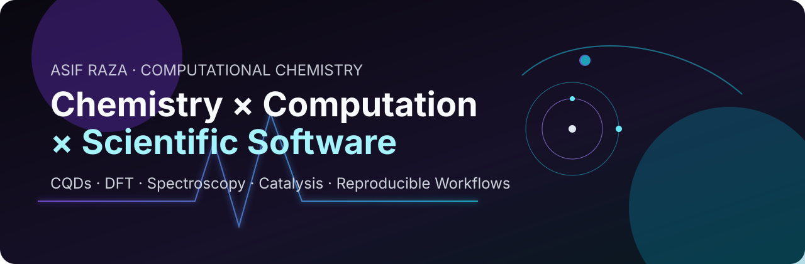
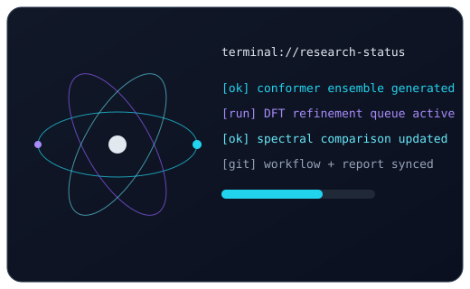
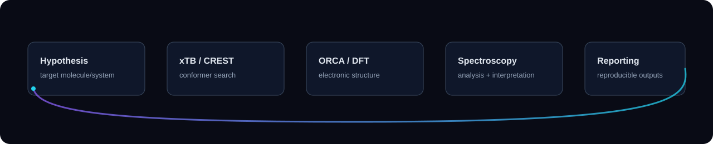
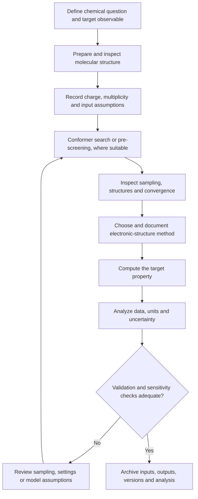

  
  
  

<code>CHEMISTRY → COMPUTATION → SCIENTIFIC SOFTWARE</code>

<strong>Asif Raza</strong> · M.Sc. Chemistry · Jamia Millia Islamia

<em>Computational chemistry · Molecular modelling · Spectral analysis · Research software</em>

---

## Navigation

[Research profile](#research-profile) · [Selected projects](#selected-projects) · [Computational workflow](#computational-workflow) · [Reproducibility](#reproducibility-and-validation) · [Methods and tools](#methods-and-tools) · [Development priorities](#development-priorities) · [Contact](#contact)

---

## Research profile

I am an M.Sc. Chemistry student at Jamia Millia Islamia interested in the use of computation and scientific programming to investigate chemical systems and make analysis workflows more reproducible.

My interests include molecular structure and conformational analysis, electronic-structure calculations, spectroscopy, asymmetric catalysis, and scientific software. I work on tools that connect chemical questions with inspectable computational steps, structured outputs, and analysis that can be revisited by another researcher.

> **Scope note:** Research interests, software capabilities, and validated scientific findings are different things. Project descriptions below identify the purpose of each repository; method-specific claims and results should be assessed from that project's documentation and data.

## Research questions

| Area | Questions and computational interests |
|:--|:--|
| **Molecular modelling** | How do conformational preferences and molecular structure affect computed properties? |
| **Electronic structure** | How should a computational protocol be selected, documented, and checked for a particular chemical question? |
| **Spectral analysis** | How can signals be processed, peaks characterized, and figures generated without losing traceability to the input data? |
| **Asymmetric catalysis and nonlinear effects** | How can conformer ensembles and thermodynamic models support exploratory analysis of nonlinear effects? |
| **Scientific software** | How can computational steps, parameters, intermediate files, and final outputs be made easier to inspect and reproduce? |

These are areas of interest, not a claim that every question has already been answered or experimentally validated.

---

## Selected projects

The projects below represent different parts of my work: computational workflow orchestration, scientific data analysis, chemical drawing, and a documented learning series.

<table>
  <tr>
    <td width="50%" valign="top">
      <h3><a href="https://github.com/asifverse4/ASIF_iAKv2026">ASIF_iAKv2026</a></h3>
      
<strong>Computational workflow orchestration</strong>

      
A workflow-oriented project for molecular and supramolecular systems, organized around structure preparation, conformer exploration with xTB/CREST, and subsequent quantum-chemical calculations with ORCA where appropriate.

      
<code>xTB</code> · <code>CREST</code> · <code>ORCA</code>

      
<a href="https://github.com/asifverse4/ASIF_iAKv2026">Repository and documentation ↗</a>

    </td>
    <td width="50%" valign="top">
      <h3><a href="https://github.com/asifverse4/Automated-Non-Linear-Effect-NLE-Predictors">NLE Predictors</a></h3>
      
<strong>Exploratory computational screening</strong>

      
A project investigating nonlinear effects in asymmetric catalysis using conformational sampling, xTB/CREST, ORCA/DFT, and Kagan ML2 thermodynamic modelling.

      
<code>PYTHON</code> · <code>CONFORMER ENSEMBLES</code> · <code>THERMODYNAMIC MODELLING</code>

      
<a href="https://github.com/asifverse4/Automated-Non-Linear-Effect-NLE-Predictors">Repository, tests and documentation ↗</a>

    </td>
  </tr>
  <tr>
    <td width="50%" valign="top">
      <h3><a href="https://github.com/asifverse4/LabScribber">LabScribber</a></h3>
      
<strong>Spectral and scientific data analysis</strong>

      
A Python-based scientific analysis platform for spectrum processing, peak detection and fitting, multivariate analysis, and figure/report generation.

      
<code>PYTHON</code> · <code>SPECTRAL ANALYSIS</code> · <code>VISUALIZATION</code>

      
<a href="https://github.com/asifverse4/LabScribber">Repository and usage notes ↗</a>

    </td>
    <td width="50%" valign="top">
      <h3><a href="https://github.com/asifverse4/HasimDraw-PRO">HasimDraw-PRO</a></h3>
      
<strong>Chemical drawing and molecular workflows</strong>

      
An offline-oriented chemical drawing and computational chemistry workstation project, with a focus on molecular structures, conformer workflows, and local cheminformatics tooling.

      
<code>TYPESCRIPT</code> · <code>RDKit</code> · <code>MOLECULAR MODELLING</code>

      
<a href="https://asifverse4.github.io/HasimDraw-PRO/">Project site ↗</a> · <a href="https://github.com/asifverse4/HasimDraw-PRO">Source code ↗</a>

    </td>
  </tr>
</table>

  
<strong>Learning series — 100 Days of Computational Chemistry</strong>

   
  A structured Python learning series covering computational chemistry, molecular modelling, data analysis, and scientific programming through practical, documented exercises.

  [Explore the repository, day-by-day material, and roadmap ↗](https://github.com/asifverse4/100-days-of-computational-chemistry)

---

## Computational workflow

The diagram below is a **protocol template**, not a universal recipe. The appropriate method and sequence depend on the molecular system, the target observable, and the accuracy required.

  

  
<strong>Protocol details worth recording</strong>

   

  - **System definition:** structure source, protonation/tautomer choice where relevant, charge, multiplicity, and atom mapping.
  - **Sampling:** software and version, search settings, constraints, duplicate handling, and how representative structures were selected.
  - **Electronic structure:** method/functional, basis set, dispersion treatment, solvent model, integration settings, convergence criteria, and relevant software version.
  - **Thermochemistry:** temperature, standard state, energy corrections, and units used in any free-energy comparison.
  - **Property calculation:** specify the observable and its computational settings; a geometry optimization alone does not establish a spectroscopic assignment or a mechanistic conclusion.
  - **Analysis:** state how structures or conformers were weighted, how values were compared, and how uncertainty or sensitivity was assessed.
  - **Provenance:** retain input files, logs, intermediate structures, scripts, environment information, and generated figures/tables.

---

## Reproducibility and validation

A computational result is only interpretable in the context of the model and settings that produced it. For projects that generate scientific results, I aim to make the following inspectable:

| Record | Why it matters |
|:--|:--|
| Input structures and parameters | Establishes what was actually calculated |
| Software versions and environment | Helps identify implementation and compatibility differences |
| Method and convergence settings | Makes the approximation and numerical criteria explicit |
| Intermediate and final outputs | Allows the workflow to be traced and failures diagnosed |
| Analysis scripts, units and plots | Makes transformations from raw output to reported result reviewable |
| Benchmarks, controls or reference data, where available | Helps assess whether the result is plausible for the intended use |

Predictions are not experimental observations. Automated workflows can improve consistency, but they do not replace chemical judgement, method validation, or experimental confirmation where that is required.

---

## Methods and tools

| Use | Tools / methods |
|:--|:--|
| Scientific programming | Python; data processing and plotting libraries as required by each project |
| Molecular informatics | RDKit and related molecular representation tools |
| Conformational exploration | xTB and CREST, where appropriate to the system and question |
| Electronic structure | ORCA and DFT methods, with protocol choices documented per calculation |
| Application development | TypeScript and browser-based tooling in HasimDraw-PRO |
| Reproducible development | Git, Linux-oriented workflows, documented environments and tests where available |

No single repository necessarily uses every tool listed here. See the individual project README for its actual dependencies, setup instructions, supported workflows, and limitations.

---

## Development priorities

- [ ] Add end-to-end examples with input files, commands, expected outputs, and environment details.
- [ ] Document the assumptions and limits of representative computational protocols.
- [ ] Expand regression tests and small reference fixtures where scientifically appropriate.
- [ ] Make data-to-figure transformations traceable in analysis projects.
- [ ] Improve installation, dependency, and troubleshooting guidance across repositories.

This is a forward-looking list; unchecked items are goals, not completed capabilities.

---

## Contact

For discussion of computational chemistry, molecular modelling, scientific Python, or research software:

- **GitHub:** [@asifverse4](https://github.com/asifverse4)
- **ORCID:** [0009-0000-3850-4907](https://orcid.org/0009-0000-3850-4907)
- **LinkedIn:** [Asif Raza](https://www.linkedin.com/in/asif-razaa-543b663b4/)

   
  
  CHEMISTRY · COMPUTATION · REPRODUCIBLE SCIENCE

